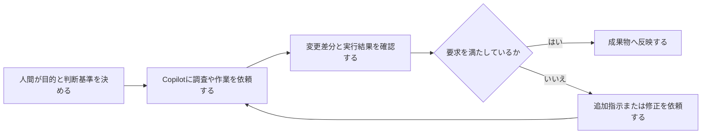

# 概要

GitHub Copilotは、プログラムの作成、修正、理解をAIで支援する開発支援ツールです。

[[VSCode]]などの対応IDEでは、入力中のコードを補完するだけでなく、コードの説明、エラー原因の調査、複数ファイルの編集、ターミナルコマンドの実行支援などにも利用できます。

単にコードを自動生成するツールというより、コードベースを参照しながら、開発者と対話して作業を進めるAIペアプログラマーに近い位置付けです。
この記事は、GitHub Copilotを実際に使いながら確認した機能や操作方法を残していくためのメモです。

# 本文

## GitHub Copilotの導入

1. GitHub上で使用する（上の方にあるCopilotアイコンでエディタ起動）
2. [[VSCode]]などのIDEから使用する（拡張機能をインストールする）
3. GitHub Copilotアプリから使用する

## VSCodeのGitHub Copilot拡張

[[VSCode]]でGitHub Copilotを使用するには、GitHub Copilotの拡張機能をインストールし、GitHubアカウントでサインインします。

GitHub Copilotを中心に、現在は次の拡張機能を使用しています。

- GitHub Copilot
  - コードの補完やCopilot Chatなど、GitHub Copilotの中心となる拡張機能
- GitHub Codespaces
  - GitHub Codespacesの開発環境をVisual Studio Codeから操作するための拡張機能
- GitHub Repositories
  - GitHubリポジトリをローカルへクローンせずに参照・編集するための拡張機能
- GitHub Pull Requests
  - Pull RequestやIssueをVisual Studio Code上で確認・操作するための拡張機能
- GitHub Copilot for Azure
  - Azureに関する調査や操作をGitHub Copilotから支援してもらうための拡張機能

## VSCodeで使用する

[[VSCode]]では、GitHub Copilotを主に次の方法で利用します。

| 利用方法         | 用途                          |
| ------------ | --------------------------- |
| インライン候補      | コードを入力しながら、続きのコードを提案してもらう   |
| Copilot Chat | 質問、コードの説明、修正方法の相談などを対話形式で行う |
| Agentモード     | 複数ファイルの編集やコマンド実行を含む作業を依頼する  |
| Planモード      | コードを変更する前に、調査と実装計画を作成してもらう  |

### インライン候補

コードやコメントを入力すると、GitHub Copilotが続きのコードを薄い文字で提案します。
例えば、Pythonファイルに次のようなコメントを書くと、その内容に対応するコードが提案されることがあります。

```python
# 指定したディレクトリ内のログファイルを一覧表示する
```

提案されたコードは、そのまま採用することも、一部分だけ採用することもできます。
以前は、この使い方を自分のメモ内で「コメントモード」と呼んでいましたが、コメントの入力はCopilotに意図を伝える方法の一つです。

#### コード提案時の操作方法

インライン候補が表示されたときは、ショートカットキーで候補を操作できます。
以下は、Windows版Visual Studio Codeの主な既定ショートカットです。

| 機能              | ショートカット          |
| --------------- | ---------------- |
| 提案を受け入れる        | `Tab`            |
| 提案を拒否する         | `Esc`            |
| 次の提案を表示する       | `Alt + ]`        |
| 前の提案を表示する       | `Alt + [`        |
| インライン候補を手動で表示する | `Alt + \`        |
| 別ペインに複数の候補を表示する | `Ctrl + Enter`   |
| Copilot Chatを開く | `Ctrl + Alt + I` |
| インラインチャットを開く    | `Ctrl + I`       |
実際の割り当ては、[[VSCode]]の「キーボード ショートカット」で「Copilot」またはコマンド名を検索すると確認できます。

### Copilot Chat

Copilot Chatでは、[[VSCode]]のチャット欄（右下）からGitHub Copilotに質問できます。
例えば、次のような用途に利用できます。

- 選択したコードの処理内容を説明してもらう
- エラーの原因を調べてもらう
- コードの修正案を作成してもらう
- リファクタリング方法を提案してもらう
- テストコードを作成してもらう
- プロジェクト内のファイル構成を調査してもらう
- 使用しているライブラリや設定について質問する

単発のコード生成だけでなく、既存コードを読みながら不明点を質問できることが大きな利点です。

### Agentモード

Agentモードでは、GitHub Copilotに比較的大きな単位の作業を依頼できます。
例えば、次のような作業が対象になります。

- 関係するファイルを調べる
- 複数のファイルを修正する
- 必要なファイルを新規作成する
- ターミナルコマンドを提案・実行する
- 実行結果やエラーを確認して修正を続ける

Copilotは指示された内容から必要な作業を判断し、複数の手順を順番に進めます。
ただし、生成されたコードや実行するコマンドが常に正しいとは限りません。変更差分とコマンドの内容を確認しながら使用する必要があります。

### Planモード

Planモードでは、すぐにコードを変更せず、最初に対象の調査と実装計画を作成します。
次のような場合に向いています。

- どのファイルを修正するのか分からない
- 変更範囲が複数ファイルにまたがる
- 既存の構造を確認してから作業したい
- 実装前に手順や影響範囲を整理したい

作成された計画を確認した後、Agentモードへ渡して実装を開始することもできます。
自分で構造を理解して判断し、実際の調査や作業をGitHub Copilotに支援してもらう場合にも使いやすいモードです。

## GitHub Copilotを使用するときの注意点

GitHub Copilotの提案は、そのまま採用するのではなく、コードレビューと同じように確認する必要があります。

特に、次の点を確認します。

- 要求した処理になっているか
- 存在しない関数やオプションを使用していないか
- 現在使用しているバージョンに対応しているか
- 例外処理や境界条件が不足していないか
- 認証情報や秘密情報がコードに含まれていないか
- 不要なファイルまで変更していないか
- 実行するコマンドが環境へ与える影響を理解できているか

GitHub Copilotは作業を代わりに判断してくれる場面もありますが、最終的な要件の判断と、生成された成果物の確認は人間側で行います。

## 使い分け

私は現在、GitHub CopilotとM365 Copilotを次のように使い分けています。

- M365 Copilot
  - 作業内容の整理
  - 調査内容の記録
  - 最初のMarkdown作成
  - 作業全体の進行管理
  - GitHub Copilotのプロンプト作成
  - ソースコードの解析
- GitHub Copilot
  - ソースコードの作成と修正
  - 複数ファイルをまたぐ変更
  - ローカル環境での実行と確認
  - 繰り返しテストしながらコーディングする作業

GitHub Copilotの利点は、開いているプロジェクトやファイルを対象として、そのまま変更と検証へ進められることにあります。
一方で、要求や判断基準が曖昧なまま作業を任せると、意図とは異なる方向へ進むことがあるので、M365 Copilotで整理してから依頼することにしています。

ソースコードの解析や修正の提案はどちらでも出来るのですが、GitHub Copilotでは、利用する機能やモデルによってAIクレジットを消費するため、ソースコードの整理はM365 Copilotで行い、繰り返し編集と実行が必要な作業はGitHub Copilotで実施しています。

この流れを図にすると以下のようになります。



GitHub Copilotを使いこなすには、AIへの指示方法だけでなく、[[VSCode]]、Git、GitHub、ファイル操作、検索、差分確認などの基本操作も重要になります。

# 参考資料

## 公式ドキュメント

- [IDEでGitHub Copilotを使用するためのクイックスタート](https://docs.github.com/ja/copilot/get-started/quickstart-for-using-github-copilot-in-your-ide?tool=vscode)
- [IDEのGitHub Copilotのキーボードショートカット](https://docs.github.com/ja/copilot/reference/keyboard-shortcuts?tool=vscode)
- [IDEでAgentモードを使用する](https://docs.github.com/ja/copilot/how-tos/copilot-in-your-ide/use-copilot-agents/use-agent-mode?tool=vscode)
- [IDEでPlanモードを使用する](https://docs.github.com/ja/copilot/how-tos/copilot-in-your-ide/use-copilot-agents/use-plan-mode?tool=vscode)

## 書籍・学習資料

### 【書籍】[はじめに｜サクッと始めるAIネイティブ開発【GitHub Copilot / ChatGPT】](https://zenn.dev/umi_mori/books/ai-native-programming/viewer/intro)

実際の使い方やテクニックを記載した書籍「サクッと始めるAIネイティブ開発」がZennで全て公開されている。
GitHub Copilotの概要、インストール方法、コード補完、コード生成、デバッグ、レビューなどを扱っているので、これを読んで一通り実行したら、VSCodeでGitHub Copilotを利用する方法については充分な基礎知識が得られる。
